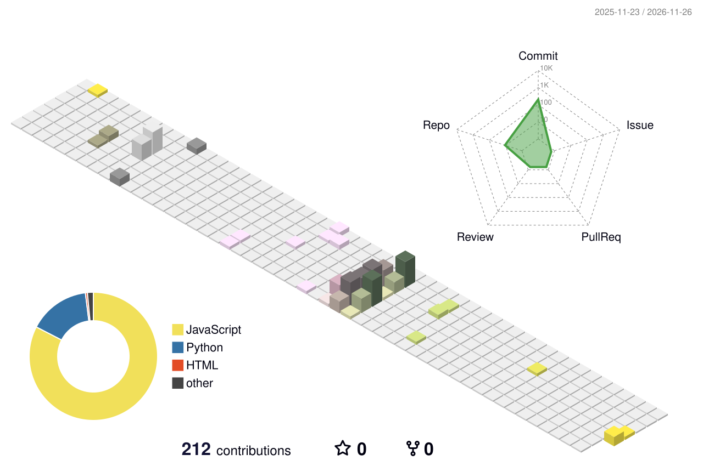

<!-- Animated wave header -->
<p align="center">
  
</p>

<!-- Typing animation -->
<p align="center">
  <a href="https://github.com/Akash140605">
    
  </a>
</p>

<p align="center">
  
  
  
</p>

---


## 👨‍💻 About me

```js
const akash = {
  education:  "B.Tech in Computer Science & Information Technology — graduated 2026 🎓",
  role:       "Full-Stack Developer",
  buildsWith: ["React", "Vite", "Tailwind", "PHP", "Python", "Flask", "SQL Server", "MySQL"],
  workingOn:  "Line Pulse — real-time production & OLE dashboards for electronics assembly lines",
  interests:  ["Manufacturing analytics", "AgriTech", "Machine Learning", "Clean UI"],
  motto:      "Ship it, measure it, make it better.",
};
```

- 🏭 Built **Line Pulse** — live line screens & TV walls, hour-by-hour target vs actual, Availability · Performance · Quality dashboards, FPY / RTY, KPI reports with Excel export, 700+ automated calculation tests
- 🌿 Trained a **CNN** that recognises plant diseases from a single leaf photo
- 🐄 Built **PashuSeva** — a marketplace + vet-consultation platform for Indian farmers
- 🌐 Designed and shipped websites for consultancies, associations and local brands

## 🧰 Tech stack

<p align="center">
  <a href="https://skillicons.dev">
    
  </a>
</p>

## ⭐ Featured projects

<table>
<tr>
<td width="50%" valign="top">

### 🐄 [PashuSeva](https://github.com/Akash140605/PashuSeva)
Livestock support platform for Indian farmers — buy & sell cattle feed (chara, bhusa) from local suppliers and consult verified vets.<br/>
`React` `MUI` `PHP` `MySQL`

</td>
<td width="50%" valign="top">

### 🌿 [PhasalAI](https://github.com/Akash140605/phasalai)
Plant disease recognition — upload a leaf photo, a CNN tells the disease and the cure.<br/>
`Python` `Flask` `TensorFlow`

</td>
</tr>
<tr>
<td valign="top">

### 💸 [Kharcha](https://github.com/Akash140605/kharcha)
Offline money-manager PWA — recurring auto-cut, split bills, budgets, analysis, backup & restore.<br/>
`JavaScript` `PWA` `Service Worker`

</td>
<td valign="top">

### 🔍 [CodeMatcher](https://github.com/Akash140605/codematcher)
Barcode / QR matching station — scan every label of a product, get an instant OK / NOT OK.<br/>
`React` `Vite` `ZXing`

</td>
</tr>
<tr>
<td valign="top">

### 🎬 [Movie Recommender](https://github.com/Akash140605/movie)
Content-based recommendations using cosine similarity over movie tags.<br/>
`Python` `scikit-learn` `Streamlit`

</td>
<td valign="top">

### 🌐 Websites
[Naachelios](https://naac.ownsite.in) · [Poetry Hub](https://poetryhub.ownsite.in) · [Kushal Youth](https://github.com/Akash140605/KushalYouth) · [Bar Association Bisalpur](https://github.com/Akash140605/Tehsil-Bar-Association-Bisalpur) · [What's A Sandwich](https://github.com/Akash140605/Whats-a-Sandbich)

</td>
</tr>
</table>

## 🧊 Contributions in 3D

<p align="center">
  <picture>
    <source media="(prefers-color-scheme: dark)" srcset="./profile-3d-contrib/profile-night-rainbow.svg" />
    
  </picture>
</p>

## 📊 GitHub stats

<p align="center">
  
  
</p>
<p align="center">
  
</p>
<p align="center">
  
</p>

## 🐍 Contribution snake

<p align="center">
  <picture>
    <source media="(prefers-color-scheme: dark)" srcset="./dist/github-snake-dark.svg" />
    
  </picture>
</p>

<!-- Animated wave footer -->
<p align="center">
  
</p>
